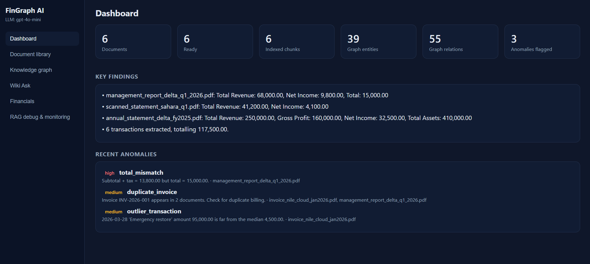
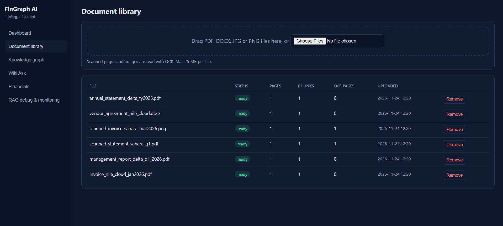
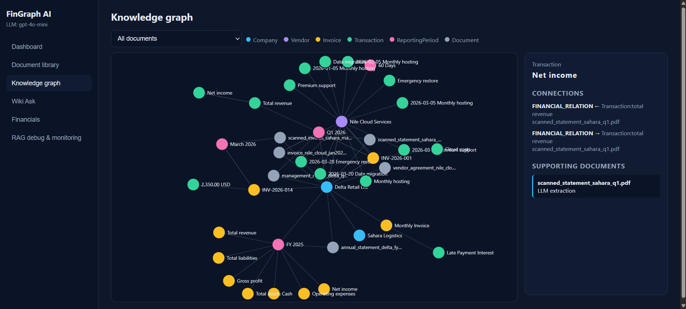
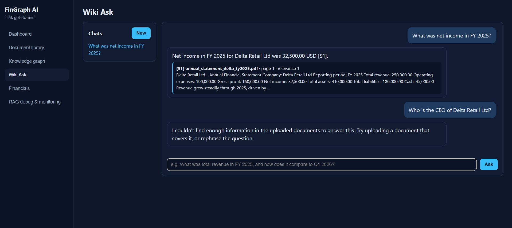
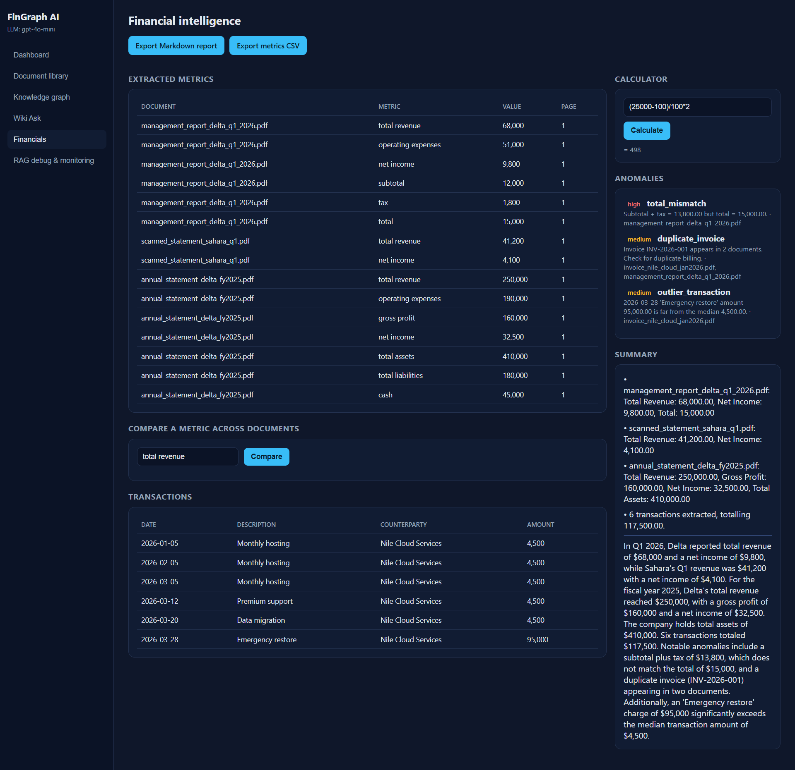
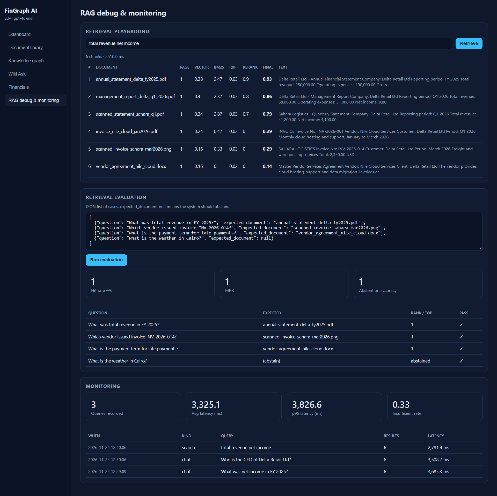

# FinGraph AI: Financial Intelligence Workspace

An application for uploading financial documents, building a searchable knowledge base, exploring entities and relationships in a knowledge graph, and asking questions with grounded, cited answers.

Built with Python (FastAPI), SQLite, OpenAI for embeddings and chat, Tesseract for OCR, and a single-file web UI with no build step. All sample data is synthetic.

## Features

| Requirement | Where it is implemented |
|---|---|
| Upload PDF, DOCX, JPG, PNG | `POST /api/documents`, validated by type and size |
| Text extraction and OCR for scans | `backend/app/parsing.py`: text layer first, OCR when a page has no text |
| Processing status and removal | Library tab, status `uploaded / processing / ready / failed`, `DELETE /api/documents/{id}` |
| Chunking, embeddings, vector storage, retrieval | `chunking.py`, `llm.py`, `store.py`, `rag.py` |
| Metadata and source references | Every chunk keeps document, page and index; citations show them |
| Grounded answers, insufficient information | `rag.answer`: cited `[S#]` answers, or an explicit "not enough information" reply |
| Knowledge graph | Force-directed SVG view; click an entity for connections and supporting excerpts |
| Entities: companies, vendors, invoices, transactions, periods | `extraction.py` (rules, plus an optional LLM pass) |
| Wiki Ask with citations, multi-document questions, history | Chat tab; per-document diversity in retrieval; conversation stored in SQLite |
| Financial metrics, comparisons, calculations, summary | Financials tab: metrics, `/api/compare`, `/api/calculate`, key findings |
| Dashboard, library, graph, Wiki Ask, loading and error states | All present in the UI |

### Bonus features

- **Hybrid search and reranking:** BM25 and vector search fused with reciprocal rank fusion, then reranked by the LLM when available, otherwise by query-term coverage.
- **Financial anomaly detection:** subtotal + tax ≠ total, net income above revenue, the same invoice in several documents, outlier transactions (median absolute deviation).
- **Document comparison:** `/api/compare` shows one metric across documents with changes against the first and the previous document.
- **RAG debugging playground:** the Debug tab shows each retrieved chunk with its vector, BM25, RRF, rerank and final scores.
- **Retrieval evaluation:** `POST /api/eval` reports hit rate @k, MRR and abstention accuracy for a list of test cases.
- **Monitoring:** query latency (average and p95), insufficient-answer rate, recent queries.
- **Exportable reports:** Markdown report (`/api/report.md`) and metrics CSV (`/api/report.csv`).
- **Local and cloud LLMs:** set `OPENAI_BASE_URL` to any OpenAI-compatible server (for example Ollama) to run models locally.

## Quick start

Requirements: Python 3.11 or newer, and Tesseract OCR installed (`brew install tesseract`, `apt install tesseract-ocr`, or the Windows installer).

```bash
git clone <your-repo-url> fingraph && cd fingraph
python3 -m venv .venv && source .venv/bin/activate
pip install -r backend/requirements.txt

cp .env.example .env          # then set OPENAI_API_KEY=sk-...
./run.sh                      # open http://localhost:8000
```

Without an API key the app still runs in **offline mode**. Retrieval uses a simple hashed bag-of-words embedder, and answers are the most relevant excerpts instead of generated text. The UI shows which mode is active. Offline mode is for demonstrating the pipeline only; use OpenAI for real answer quality.

### Using a local model (optional)

```bash
# Ollama example, in .env
OPENAI_BASE_URL=http://localhost:11434/v1
OPENAI_API_KEY=ollama
CHAT_MODEL=llama3.1
EMBED_MODEL=nomic-embed-text
```

## Screenshots

| | |
|---|---|
|  |  |
|  |  |
|  |  |

## Sample data

Synthetic files are in `samples/`. To regenerate them:

```bash
python scripts/make_samples.py
```

| File | Type | What it tests |
|---|---|---|
| `invoice_nile_cloud_jan2026.pdf` | Digital PDF invoice | Invoice, vendor, period, totals, transaction table, outlier amount |
| `annual_statement_delta_fy2025.pdf` | Digital PDF statement | Revenue, net income, assets, multi-document comparison |
| `management_report_delta_q1_2026.pdf` | Digital PDF report | Subtotal + tax mismatch (anomaly), duplicate invoice reference |
| `vendor_agreement_nile_cloud.docx` | DOCX contract with a table | DOCX parsing, payment terms, table text |
| `scanned_invoice_sahara_mar2026.png` | Image invoice | OCR on a PNG |
| `scanned_statement_sahara_q1.pdf` | Image-only PDF | OCR fallback for a scanned PDF page |

Good demo questions:
- "What was total revenue in FY 2025, and how does it compare with Q1 2026?"
- "Which vendor issued invoice INV-2026-014?"
- "What are the payment terms for late invoices?"
- "What is the weather in Cairo?" (should abstain)

## Tests

```bash
cd backend && python -m pytest -q
```

The 29 tests run fully offline. They cover parsing and OCR, chunking, retrieval, abstention, extraction rules, anomaly checks, the API (upload, delete, chat, graph, compare, report, evaluation), and the LLM code paths via a scripted fake provider.

## Project structure

```
backend/app/        config, parsing, chunking, llm, store, extraction, rag, main (API)
backend/tests/      pytest suite
frontend/           index.html (single-page UI)
scripts/            make_samples.py (synthetic data)
samples/            generated test documents
docs/               architecture.md (diagram), RAG_NOTES.md (design decisions)
run.sh              start the server
```

## Configuration

| Variable | Default | Purpose |
|---|---|---|
| `OPENAI_API_KEY` | empty | Enables OpenAI embeddings, chat, LLM rerank and LLM extraction |
| `OPENAI_BASE_URL` | empty | Use an OpenAI-compatible server instead |
| `EMBED_MODEL` | `text-embedding-3-small` | Embedding model |
| `CHAT_MODEL` | `gpt-4o-mini` | Answer and rerank model |
| `CHUNK_SIZE`, `CHUNK_OVERLAP` | `800`, `120` | Characters per chunk and overlap |
| `TOP_K` | `6` | Chunks passed to the answer step |
| `MIN_VECTOR_SCORE` | `0.25` | Below this (with no keyword match), the question is treated as unanswerable |
| `MAX_UPLOAD_MB` | `25` | Upload size limit |
| `FINGRAPH_DATA_DIR` | `./data` | Where the SQLite database and uploads are stored |

## Security and privacy notes

- Do not upload real customer financial data for this assessment. Use the synthetic samples.
- Uploaded files and the database live in `data/` (git-ignored). Delete a document in the UI to remove its chunks, facts and file.
- There is no authentication. This is a single-user local tool, not a multi-tenant service.

## Documentation

- [docs/architecture.md](docs/architecture.md): system diagram and components
- [docs/RAG_NOTES.md](docs/RAG_NOTES.md): pipeline, technical decisions, limitations and improvements
